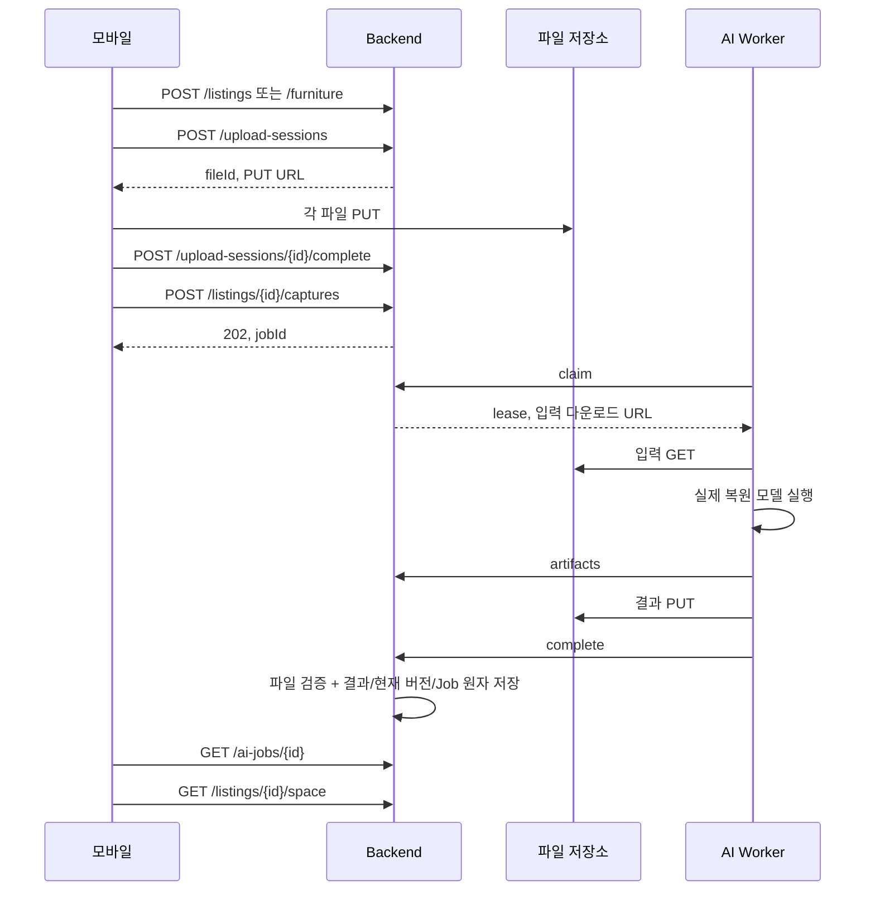

# 둘러방 백엔드 v1.1

`api-spec-v1.1-changes.md`와 사용자 확정 결정을 반영한 **59개 API / 44개 경로 / 106개 모델**의 FastAPI 서버입니다. 기준은 `/api/v1`, 문서 버전은 `1.1.0`입니다. 입력과 성공 응답을 동봉 OpenAPI JSON Schema로 검사합니다.

## 반영한 계약

- 카카오·구글·이메일 로그인. 소셜 계정은 제공자 회원번호로 찾으며 같은 이메일의 계정을 자동 연결하지 않습니다.
- 누구나 본인 매물 등록. 일반 소유자는 `owner/ownerId`, 인증 소유 중개사는 `ListingAgent/LISTING_AGENT`입니다. 인증 신청 경로는 `/users/me/listing-agent-verification`, 증빙 업로드 목적은 `LISTING_AGENT_DOCUMENT`입니다.
- 금액은 **원(KRW) 정수**, 주소는 `location` 객체입니다. `roomType`, 총층·공급면적·방/욕실 수·입주일·생활 환경·옵션 3종과 카드 필드를 추가했습니다. 제목·설명·법정동 코드는 선택입니다.
- 상세 주소는 소유자 상세 조회에만, 일반 소유자의 전화는 `isPhonePublic=true`일 때만 공개합니다.
- `q` 주소 단어별 AND, 반복 `roomType` OR, 기존 원 단위 가격·면적 필터, 지도 경계 네 값과 지도 최대200개를 지원합니다.
- `AssetRef.url/urlExpiresAt`을 파일 응답에 채웁니다. 만료하면 `/assets/{fileId}/download`로 갱신합니다. 파일 GET 주소는 멱등 재생에서도 새로 발급합니다.
- 관심매물 PUT/DELETE204, 신고 최초201·같은 사용자/매물24시간 중복200, 채팅6API·신규201/기존200·메시지 멱등·읽음·미읽음 수를 구현했습니다.
- 실내 선택 입력은 DEPTH PNG uint16 mm, CONFIDENCE PNG8 0/1/2, ROOMPLAN JSON, ROOMPLAN_STRUCTURE JSON입니다. 프레임의 파일 ID·개수·해상도·실제 바이트를 검증하고 워커에 전달합니다.
- 창문은 중심 position와 `sillHeight`로 저장하며 충돌 대상에서 제외합니다.
- 사용자 결정에 따라 `inputSha256`은 선택이고 서버 검증하지 않습니다. `collisionFileSha256s` 요청 입력을 제거했으며 공간·가구 버전으로 배치 `isStale`을 판단합니다.
- 추천 API는 추가하지 않고 최신순/필터를 유지합니다. 입주 상태는 **작성자만 조회**합니다. AI 결과 형식은 담당 확인 전까지 v1 규격을 유지합니다.

명세의 전체 필드·헤더·예시는 `app/contract/openapi.json`, 상호 필드 규칙은 `app/contract/명세_상세규칙.md`에 있습니다. 실제 AI 엔진과 모바일 앱 연결은 별도이며, 백엔드가 복원 알고리즘을 자동 실행하지 않습니다.

## v1 데이터 이관

실행 전 CLI `backup`으로 DB와 `objects`·비밀키를 함께 보존하십시오. 첫 시작에서 기존 역할과 소유 ID·방 종류 JSON을 원자 변환합니다. **원 금액·주소 객체·3D 파일 바이트는 유지**합니다. VILLA/APARTMENT는 방 수를 알 수 없어 임시 분류와 검토 표시를 저장하고 PUBLISHED를 DRAFT로 바꿉니다. 소유자가 `PATCH {roomType: ...}`로 확인한 뒤 다시 게시해야 합니다.

같은 `/api/v1`에서도 이전 `propertyType/brokerId` 요청은 거절하므로 모바일을 함께 갱신해야 합니다. 이전 서버로 롤백하려면 백업 DB·파일·비밀키를 복구하십시오.

## 소셜 로그인 설정

`.env`를 자동으로 읽지 않으므로 셸/Compose 환경에 직접 주입하십시오.

```powershell
$env:KAKAO_APP_ID="카카오 앱 숫자 ID"
$env:GOOGLE_CLIENT_IDS="허용 Google client ID,추가 client ID"
```

카카오는 공식 토큰 정보·사용자 정보 API로 앱 ID/회원번호/만료를 검증합니다. 구글은 공식 JWKS의 RS256 서명과 issuer/audience/만료를 검증합니다. 미설정은503 `OAUTH_NOT_CONFIGURED`, 잘못된 토큰401 `INVALID_OAUTH_TOKEN`, 제공자 장애503입니다. 모바일 SDK 앱 키·ID도 개발자 콘솔에서 설정해야 합니다. 실제 앱 키·토큰은 소스나 압축파일에 넣지 않습니다.

## 바로 실행

Python 3.11 이상이 필요합니다. Windows PowerShell에서 이 폴더를 연 다음 실행하십시오.

```powershell
powershell -ExecutionPolicy Bypass -File .\scripts\run.ps1
```

스크립트는 프로젝트 안에 `.venv`를 만들고 고정된 의존성을 설치합니다. 최초 설치에는 인터넷이 필요합니다. 서버를 종료하려면 해당 터미널에서 `Ctrl+C`를 누르십시오.

- Swagger: <http://127.0.0.1:8000/docs>
- OpenAPI: <http://127.0.0.1:8000/openapi.json>
- 상태 확인: <http://127.0.0.1:8000/health/ready>

수동 실행 또는 macOS/Linux에서는 다음 명령을 사용하십시오.

```text
python -m venv .venv
# Windows: .venv\Scripts\Activate.ps1
# macOS/Linux: source .venv/bin/activate
python -m pip install -r requirements.lock
python -m pip install --no-deps -e .
python -m uvicorn app.main:app_factory --factory --host 127.0.0.1 --port 8000 --no-access-log
```

개발 중 자동 재시작은 `scripts/run.ps1 -Reload` 또는 Uvicorn의 `--reload`를 사용하십시오. 다른 포트는 `scripts/run.ps1 -Port 8001`과 `PUBLIC_BASE_URL` 변경을 함께 적용하십시오.

## 계정과 첫 요청

회원 가입은 `TENANT`만 생성합니다. 앱에서 `roles`, `ownerId`를 보내면 거절합니다. 매물 등록은 모든 로그인 사용자에게 열려 있습니다. `/docs`에서 다음 순서로 실행하실 수 있습니다.

1. `POST /auth/signup`에 이메일·12~128자 비밀번호·표시 이름을 보내십시오.
2. `POST /auth/login`으로 발급받은 `accessToken`을 Swagger의 **Authorize**에 입력하십시오.
3. 소유 중개사는 증빙 업로드 뒤 `POST /users/me/listing-agent-verification`로 신청합니다. 서버 운영자가 신원·자격을 확인한 뒤 아래 명령을 실행합니다.

```text
python -m app.cli pending-reviews
python -m app.cli review-agent APPLICATION_UUID --decision approve
python -m app.cli review-agent APPLICATION_UUID --decision reject --reason "등록번호 확인이 필요합니다."
python -m app.cli review-report REPORT_UUID --decision resolve --reason "매물 정보를 확인했습니다."
```

`pending-reviews` 출력은 신청자 개인정보·신고 내용이므로 운영자 로컬에서만 취급하십시오. CLI는 같은 DATA_DIR을 사용합니다. 승인 후 기존 로그인에서도 DB 역할을 다시 읽습니다. 이전의 신뢰된 운영 계정용 명령은 `grant-listing-agent EMAIL`로 이름을 바꾸었으며 연락처가 없으면 null입니다.

생성 API에는 UUID `Idempotency-Key`를 보내십시오. 수정할 때는 최신 GET의 `ETag`를 `If-Match`로 보내십시오. 배치 최초 저장에는 `If-None-Match: *`, 이후 수정에는 `If-Match`를 사용합니다.

## 구현 구조

```text
app/
  main.py                 HTTP 라우팅·오류·요청 제한·스트리밍 저장
  core.py                 설정·JWT·암호 해시·DB·계약 검증
  service.py              도메인 규칙과 59개 API 처리
  features.py             매물 카드·검색·연락처·관심·신고·인증·채팅
  capture_inputs.py       PNG16 깊이·confidence·RoomPlan·증빙 검증
  oauth.py                카카오 app_id·사용자 토큰 / 구글 공개키·aud·exp 검증
  admin.py                인증 승인·반려·신고 처리·감사 기록
  migrate_v11.py          기존 역할·매물 소유 ID·방 종류 1회 전환
  geometry.py             카메라·이미지·PLY·GLB·좌표 검증
  worker.py               별도 AI 워커에서 사용하는 HTTP 연동 도구
  cli.py                  소유 중개사 부여·워커 토큰·큐 조회·백업
  migrations/             초기 DB 마이그레이션
  contract/               원본 OpenAPI와 operation 메타데이터
tests/                    실제 파일과 HTTP 요청을 사용하는 통합 테스트
scripts/run.ps1           Windows 실행 스크립트
requirements.lock         테스트한 직접·간접 의존성 버전
verification.json         마지막 테스트에서 성공 응답을 확인한 operation 목록
```

프레임워크 기반은 [FastAPI](https://fastapi.tiangolo.com/)이며 저장소는 [Python sqlite3](https://docs.python.org/3.13/library/sqlite3.html)를 사용합니다. JSON 리소스 테이블과 인증·멱등·outbox·큐·요청 제한 테이블을 SQLite WAL에 저장합니다. 비즈니스 변경은 `BEGIN IMMEDIATE` 트랜잭션으로 직렬화하여, 중복 생성·수정·취소/완료 경쟁을 처리합니다. 파일은 SHA-256 이름으로 저장하며 여러 파일 ID가 같은 바이트를 참조할 수 있습니다.

**현재 저장소 구성은 로컬 디스크 + SQLite의 단일 서버용입니다.** S3, Redis, RabbitMQ, PostgreSQL 연결을 구현했다고 가정해서 배포하시면 안 됩니다. 대규모·다중 호스트 운영에는 저장소와 큐 어댑터, 관계형 도메인 테이블·인덱스, 부하 시험을 추가해야 합니다.

## 기능별 처리

| 영역 | 구현한 동작 |
|---|---|
| 인증 | Argon2 암호 해시, 15분 사용자 JWT, 14일 refresh 회전, 재사용 시 세션 폐기, 로그아웃 즉시 access/refresh 차단 |
| 권한 | 서버 역할 기준 판단, 다른 사용자 소유 자원 404, 미게시 매물 숨김, 내부 워커의 별도 JWT 발급자·대상·키·scope |
| 중복 요청 | 사용자/메서드/실제 경로/키별 24시간 기록, JCS 본문 해시, 동일 응답 재생, 다른 본문 409, 응답 기록 암호화 |
| 매물 | 생성·수정·소프트 삭제, 전세/월세 금액 검증, 필터·정렬·서명 커서, 사진 및 공간 준비 후 게시, 활성 작업이 있으면 보관 차단 |
| 업로드 | 대상·목적·소유권 결합, 개수·용량 제한, 15분 서명 PUT/GET, 전송 바이트의 크기·SHA-256 검사, 검증 후 변경 금지 |
| 촬영 검증 | 실제 JPEG/PNG 디코드, 이미지 크기, 카메라 파일 스키마, 프레임 대응·시각 순서·intrinsics·직교 회전·determinant 검사 |
| 매물 사진 | 원본은 개인 파일, 픽셀만 다시 인코딩한 별도 JPEG로 EXIF/GPS 메타데이터 제거 |
| AI 작업 | 원자적 접수와 outbox, 영속 큐, claim lease, heartbeat, 자동 3회 재시도, 수동 새 작업 재시도, 취소, 중복 완료/실패 응답 재생 |
| 공간 | 불변 `spaceVersion`, 현재 버전 포인터, 과거 공간 조회, 별도 `objectsVersion` 및 ETag로 분류 수정 |
| 입주 상태 | 원본 공간·객체 분류 스냅샷, PERSONAL/removable 객체만 제거, 개인 결과, 구조·문·남은 객체 유지 검증 |
| 가구 | 소유자별 CRUD, 불변 `modelVersion`, GLB 정점의 실제 AABB와 선언 bbox 비교, 저장 배치 참조 중 삭제 차단 |
| 배치 | 사용자/매물별 세트 1개, 전체 교체, 현재 공간·가구 버전만 저장, 재복원 시 이전 배치의 `isStale` 및 ETag 변경 |
| 충돌 보고 | quaternion 정규화, inputSha256 선택·미검증, 보고 구조·참조 검증, `CLIENT_ONLY`로 저장 |

멱등 생성 요청이 동시에 들어오면 SQLite 잠금 안에서 최초 처리를 완료한 뒤 원 응답을 재생합니다. 명세의 `IDEMPOTENCY_IN_PROGRESS` 즉시 응답 대신 **대기 후 재생**하는 로컬 구현입니다. DB 잠금 제한을 초과하면 503과 `Retry-After`를 반환합니다. 부수효과는 두 번 수행하지 않습니다.

목록 커서는 호출자·경로·필터·정렬에 묶인 30분 서명 토큰입니다. ID 목록의 영속 스냅샷을 서버에 보관해 순회 중 생성된 항목을 제외합니다. 가격 등의 값 자체는 최신 값이며 전체 데이터 스냅샷 격리를 보장하지 않습니다.

## 촬영부터 표시까지



가구는 동일 흐름에서 `/furniture/{id}/captures`와 `/furniture/{id}`를 사용합니다. 객체 제거는 `/listings/{id}/room-states`로 시작하고 `/room-states/{id}`에서 개인 결과를 읽습니다.

`UploadGrant.headers`의 두 헤더를 그대로 파일 PUT에 보내고, JSON을 base64로 감싸지 마십시오. 카메라 파일은 `CameraManifest`에 맞는 JSON 원문입니다. 세션 완료는 파일 업로드 완료와 AI 복원 완료를 의미하지 않습니다. 촬영 제출 후 3초 이상 간격으로 Job을 확인하십시오.

## AI 워커 연결

**학습 모델·3DGS 학습·인페인팅·가구 복원 알고리즘은 이 백엔드에 포함하지 않았습니다.** 별도 AI 프로세스가 처리한 실제 파일만 완료 API에 제출합니다. 가짜 결과를 자동 생성하거나 작업을 자동 완료시키지 않습니다. 워커가 없으면 작업은 대기하며, 60분을 넘기면 실패 처리합니다.

로컬 영속 큐는 다음 명령으로 확인할 수 있습니다. API의 유지관리 루프가 outbox를 큐에 반영하는 주기는 5초입니다.

```text
python -m app.cli queue --limit 20
python -m app.cli worker-token ai-worker-01 --seconds 3600
```

첫 명령은 처리 시각이 된 job ID 배열을 출력합니다. 두 번째 명령은 **워커용 비밀 토큰**을 출력합니다. 토큰을 노션·Git·로그에 저장하지 말고 워커의 환경 변수로 주입하십시오. 여러 워커가 같은 ID를 읽어도 claim에서 한 워커만 성공합니다. 큐는 로컬 DB 기반이므로 원격 AI 서버에는 운영자가 ID를 전달하거나 별도 큐 어댑터를 연결해야 합니다. 공개 사용자 API로 큐 전체를 노출하지 않았습니다.

워커 연동에는 `python -m pip install -c requirements.lock '.[worker]'`로 HTTP 클라이언트 의존성을 설치할 수 있습니다. 기본 잠금 파일을 설치한 개발 환경에는 이미 포함되어 있습니다.

```python
import os
from app.worker import WorkerClient

with WorkerClient(
    os.environ["BACKEND_URL"],
    os.environ["AI_WORKER_TOKEN"],
    "ai-worker-01",
) as worker:
    assignment = worker.claim(job_id)
    camera_json = worker.download(assignment["input"]["manifest"])
    images = [worker.download(g) for g in assignment["input"]["images"]]
    depths = {g["clientFileId"]: worker.download(g)
              for g in assignment["input"]["depths"]}
    confidences = {g["clientFileId"]: worker.download(g)
                   for g in assignment["input"]["confidences"]}
    roomplan = (worker.download(assignment["input"]["roomplan"])
                if assignment["input"]["roomplan"] else None)
    roomplan_structure = (worker.download(assignment["input"]["roomplanStructure"])
                          if assignment["input"]["roomplanStructure"] else None)
    # 여기서 팀의 실제 AI 파이프라인을 실행합니다.
    # 출력 파일의 role과 형식은 아래 표 및 OpenAPI를 따릅니다.
    # assets = worker.upload_artifacts(actual_output_bytes_by_role)
    # worker.complete(result_with_asset_refs)
```

`WorkerClient`는 30초마다 heartbeat를 보내고, lease 상실 시 새 결과 제출을 차단합니다. 15분 이상 처리하면 `worker.heartbeat(refresh_urls=True)`로 입력 URL을 재발급하십시오. 반환된 `assignment.input`을 다시 사용해야 합니다. API 응답을 받지 못한 `complete`/`fail`은 **동일 lease와 동일 body**로 재전송하십시오. `upload_artifacts`를 새 ID로 반복 호출하면 기존 role과 충돌하므로, 등록 응답과 실제 결과 body를 워커에서 보존해야 합니다.

| 작업 | 결과 role |
|---|---|
| ROOM_RECONSTRUCTION | SCENE / GEOMETRY / COLLISION |
| FURNITURE_RECONSTRUCTION | MODEL / COLLISION |
| ROOM_OBJECT_REMOVAL | SCENE / GEOMETRY / COLLISION |

워커 JWT의 `sub`와 claim의 `workerId`는 일치해야 합니다. 일반 사용자 토큰으로 내부 API에 접근할 수 없습니다. 내부 API는 운영 reverse proxy의 내부 네트워크 경로로 제한하십시오.

## 3D 파일 계약

- 공통: m 단위 `RH_Y_UP_Z_BACK`, quaternion `{x,y,z,w}`. 가구 pivot은 바닥 중심입니다.
- SCENE: 고정 14개 float32 속성의 `DULLEOBANG_GS_PLY_V1`, little-endian, 최대 200만 splat / 256 MiB입니다.
- GEOMETRY: `ROOM_GEOMETRY_V1` JSON, 최대 10 MiB. 결과 body의 geometry와 일치해야 합니다.
- MODEL: glTF 2.0 GLB, 최대 256 MiB. 외부 URI·압축 확장·애니메이션·스킨을 허용하지 않습니다.
- COLLISION: GLB, 최대 64 MiB / 20만 삼각형, texture 없이 사용합니다. 모든 collider node transform을 identity로 bake하십시오.

정적 GLB의 청크 길이·버퍼 범위·accessor 범위·인덱스·유한 float·루트 변환·노드 그래프·node 이름 참조를 검사합니다. 현재 프로파일은 sparse accessor와 확장을 받지 않습니다. 가구 visual mesh 정점의 AABB와 선언 bbox는 0.001m 오차 이내여야 합니다. 제거 결과의 collision에는 제거 대상 node가 없어야 합니다.

이 검사는 **AI 결과가 실제 방과 정확히 같은지, 실제 객체가 영상에서 완전히 지워졌는지**를 판정하는 품질 평가가 아닙니다. 실제 치수·복원 품질·인페인팅 품질은 별도 데이터셋과 모델 평가가 필요합니다. 서버는 모바일의 물리 충돌 계산을 수행하지 않습니다. 충돌 보고는 참고 정보이며 서버는 inputSha256을 검증하지 않습니다.

## 설정과 보관

`.env.example`은 설정 안내입니다. 앱이 `.env`를 자동으로 읽지는 않으므로 PowerShell의 `$env:NAME=...`, Linux의 `export NAME=...`, 또는 컨테이너 환경으로 주입하십시오.

| 변수 | 기본/설명 |
|---|---|
| APP_ENV | development / test / production |
| DATA_DIR | 현재 작업 폴더의 `data`; DB·객체·개발 비밀키 보관 |
| PUBLIC_BASE_URL | `http://127.0.0.1:8000`; 서명 파일 URL에서 앱/워커가 실제 접근할 수 있는 주소 |
| JWT_SECRET | 사용자 JWT 및 멱등 기록 암호화용 비밀키 |
| WORKER_JWT_SECRET | 별도 워커 JWT 비밀키 |
| STORAGE_SECRET | 파일 URL·커서 서명 비밀키 |
| CORS_ORIGINS | 쉼표로 구분한 브라우저 origin; 미설정이면 CORS 허용 없음 |

개발 모드에서는 서로 다른 임의 비밀키를 생성해 `data/development-secrets.json`에 보관합니다. 재시작 후에도 사용자 세션이 유지됩니다. 이 파일을 삭제하거나 비밀키를 교체하면 기존 토큰·커서·서명 URL·암호화 기록의 유효성이 사라집니다. 저장소 디렉터리 전체를 외부에 공개하지 마십시오.

`production` 모드는 서로 다른 32자 이상의 비밀키 세 개와 HTTPS `PUBLIC_BASE_URL`을 요구하며, 와일드카드 CORS를 거절합니다. 개발 모드의 업로드/다운로드 URL 스키마만 `http://`를 허용합니다. 운영 모드는 원본 명세의 HTTPS 규칙을 사용합니다.

휴대폰에서 테스트할 때는 `PUBLIC_BASE_URL`을 PC의 실제 LAN 주소로 바꾸고, 개발 서버를 `--host 0.0.0.0`으로 실행해야 합니다. `127.0.0.1`은 각 기기 자신을 뜻합니다. LAN 허용과 방화벽 설정은 실제 테스트 환경에 맞게 적용하십시오.

유지관리 루프는 lease 만료·큐 대기 만료·outbox 전송·24시간 멱등 기록 및 커서 만료를 처리합니다. 사용된 촬영 원본은 마지막 작업 종료 이후 30일, 만료한 미사용 업로드는 추가 24시간까지 보관합니다. 삭제된 부모의 파일은 접근을 차단하고 참조를 정리합니다. 중복 해시 파일은 살아 있는 다른 참조가 있으면 삭제하지 않습니다. 고아 디스크 객체는 24시간 유예 후 제거합니다. 삭제 tombstone은 최소 30일 동안 유지하며 그 이후 삭제 재호출의 204 특례를 제공하지 않습니다. 과거 공간·가구 모델은 부모가 살아 있는 동안 유지합니다.

수동 유지관리는 `python -m app.cli maintenance`입니다. DB 백업은 다음 명령을 사용하십시오.

```text
python -m app.cli backup backend-backup.sqlite3
```

파일 객체 및 비밀키 설정도 함께 안전하게 백업해야 복구할 수 있습니다. DB 파일만 별도로 복사할 때는 WAL 일관성을 고려해야 하므로 위 online backup 명령을 사용하십시오.

## 테스트와 검증 범위

```text
python -m pytest -q
python -m ruff check app tests
python -m ruff format --check app tests
```

테스트는 외부 AI·스토리지·메일·유료 서비스를 호출하지 않습니다. 임시 디렉터리의 실제 SQLite와 실제 JPEG·CameraManifest·PLY·GLB 바이트로 HTTP 흐름을 검증합니다. 아래 내용을 포함합니다.

- 59개 operation의 등록 및 실제 성공 응답.
- 회원 가입 역할 제한, refresh 회전·동일 키 재생·재사용 폐기·로그아웃 차단.
- 소유권, 다른 사용자 자원 숨김, 미게시 매물 접근 제한.
- 실제 파일 무결성, 이미지·manifest 검사, 검증된 파일 변경 차단.
- outbox·큐, worker scope, lease 경쟁, heartbeat, 자동/수동 재시도, 취소.
- 공간/가구 완료, 원자적 실패, 게시, 개인 객체 제거, 배치·참조 삭제 제한.
- 과거 버전, 새 복원 후 배치 stale 처리, 동시 생성 및 ETag 수정 경쟁.
- 재시작 후 데이터·인증 유지, 요청 제한, JSON 크기 제한.

`verification.json`은 마지막 전체 테스트 결과의 operation 목록입니다. 일부 테스트만 실행하면 그 실행 범위로 갱신됩니다. 최종 검증 결과와 실행 환경은 `검증결과.md`에 정리했습니다.

Docker가 설치되어 있으면 `docker compose up --build`로 실행할 수 있습니다. GitHub Actions 설정은 Windows/Linux와 Python 3.11/3.13 조합의 검증을 정의합니다. Docker 빌드와 원격 CI는 이 환경에서 실행했다고 간주하지 마십시오.

실서비스 전환에는 TLS·내부 경로 제한·비밀키 관리·저장 용량 관리·백업 복구 시험·부하 시험과 AI 워커 연결이 필요합니다. 이메일 인증·비밀번호 재설정·결제·계약·추천 알고리즘·푸시/WebSocket은 이번 범위에 포함하지 않았습니다.
